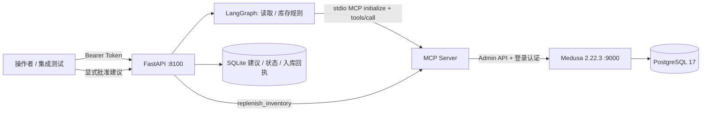

# 架构与业务逻辑

Medusa 保有商品、订单、库存和预留数据的唯一业务事实来源。Agent 不直接读写 PostgreSQL。官方管理后台与 Agent 查询的是同一数据库。

LangGraph 使用 `read_medusa_via_mcp → inventory_policy` 两个节点。MCP 提供 `list_products`、`list_orders`、`list_inventory`、`replenish_inventory`。读取分页，超过 10000 条时失败而非静默分析不完整数据。

库存规则按每个库存项、每个库位计算：

- 可用库存 = 账面库存 − 已预留库存。
- 当可用库存 < 10，生成预警；目标可用库存默认 30。
- 建议补货量 = 目标可用库存 − 当前可用库存。
- 参数由 API 校验，可调整阈值和目标；当前订单仅用于真实业务可见性，尚未用于销量预测。

`POST /inventory/check` 保存建议，返回建议 ID；不会自动入库。`POST /recommendations/{id}/approve` 显式批准后才经 MCP 调用 Medusa 更新库存，并再次读取核验。重复批准已应用的同一个 ID 只返回原回执。不同建议持有旧库存快照时拒绝覆盖。

建议状态：`proposed → applying → applied`；失败或结果不确定转为 `needs_review`。进程崩溃遗留 `applying` 或 `needs_review` 时不得盲目重试，应对照 Medusa 实际库存核对后再处理。

第一阶段采用单个 Uvicorn worker、进程内锁和本地 SQLite。Medusa 的设置库存 API 不提供原子 compare-and-set；当前“读快照、比较、写入”不能消除其他进程在间隙修改库存的竞争。仅适用于受控演示，生产需在 Medusa 工作流中添加分布式锁、事务与幂等收货编号，再启用多实例和第三方库存写入。

当前补货是虚构仓库的模拟收货，不是向供应商下单或付款。没有 LLM API 调用，也不需要外部模型密钥。
