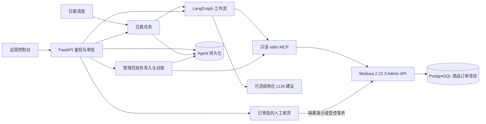

# EcomOps Agent 架构与业务逻辑

Medusa 持有商品、订单、库存、履约和预留。Agent 使用 Admin API 读取这些数据。
API、调度和 MCP 分别服务于操作者、重复任务和机器读取。
MCP 通过标准 SDK 执行 stdio 握手，提供 `list_products`、`list_orders`、
`list_inventory` 和 `read_daily_report`。日报工具要求本地服务显式启用
`ECOMOPS_MCP_REPORT_READ=1`，返回保存的汇总字段。

## 工作流与数据边界

- 库存按库存项和仓库观察账面、预留和可用量。建议可基于阈值或按仓库归属的
  历史履约量、提前期及安全库存。归属或历史不足时回退到阈值规则。
- 订单工作流读取履约状态、销售渠道、可用仓库、订单行与预留记录。规则独立判断
  SLA 与缺货。证据不全时返回未知。告警 ID 按订单和规则去重，扫描保留人工状态。
- 日报以 IANA 时区确定半开统计区间，对照上一营业日，按币种记录非取消订单金额。
  支付事件按入账日期分币种汇总捕获与退款，并保留数据来源及完整性状态。
  报告包含现场库存和告警快照时间。净营收和银行清算需要独立账目。
- LLM 接收最小化的聚合数据，只能排序已获数据支持的人工核查建议。事实摘要和建议文字由代码生成。
  模型输出和 MCP 均没有业务写入权限。API 响应和保存的日报保留 LangGraph 节点耗时。

## 权限、收货与恢复

Viewer 读取，Operator 创建提案、收货和处理告警，Admin 审批、拒绝、核对及查看审计。
审批只将提案变更为 `approved`。确认实物后，Agent 先持久化批次请求 ID、
实际数量和执行意图，再尝试 Medusa 写入。全批完成后为 `applied`，未收完时为
`partially_received`。成功批次的相同请求 ID 返回原回执，数量变化会拒绝。

Agent 的 PostgreSQL 使用独立业务 schema 和事务级同库位锁，SQLite 用于单机。
数据库保存提案、批次、库存观测、告警和处置历史、日报、日报任务与审计。
Agent 内部的领取互斥覆盖共享同一 Agent 数据库的进程。
默认收货路径在隔离演示中使用读、比较、写和回读。显式启用受控模式时，Medusa
在库存行锁内比较账面和预留量，并将库存更新与幂等回执一起提交。受控库位的其他
写入方需要协调。原生绝对写入可持旧值写回，普通共享环境默认禁写。批次执行中或结果不明时暂停该库位的收货。
管理员记录核对结论。结论仍不确定时库位继续暂停收货。进程崩溃残留的 `applying` 只通过停机维护脚本核对。

日报任务按日期和时区保存，按租约在配置窗口内逐日恢复漏跑的营业日。订单定时扫描使用独立租约，失败时退避重试，并保留人工告警状态。
更早的缺失日报可由有权限的操作者生成。历史报告保留生成时的快照。

## 独立财务数据

管理员通过清算流水和收入记录的独立 CSV 入口导入。Agent 数据库存储标准化记录和来源摘要。
对账以所选时区的清算入账日为范围，按 Medusa 交易类型和引用关联原始收款及退款。
财务收入按账目的会计日期和币种汇总。结果标注已导入数据范围。财务明细通过管理员 API 查询。
